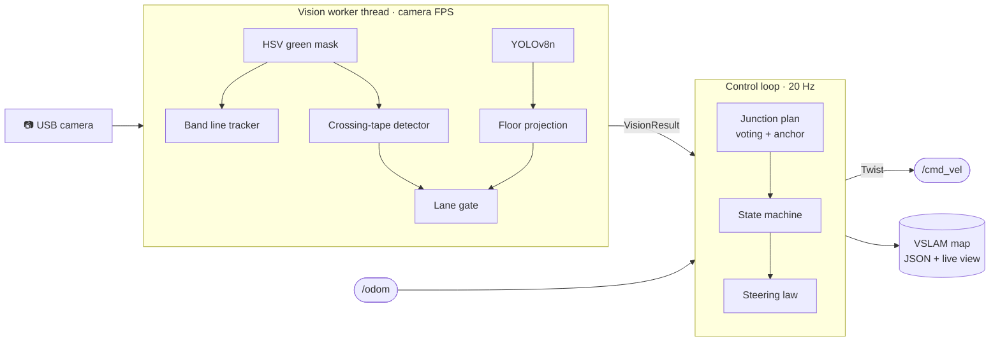
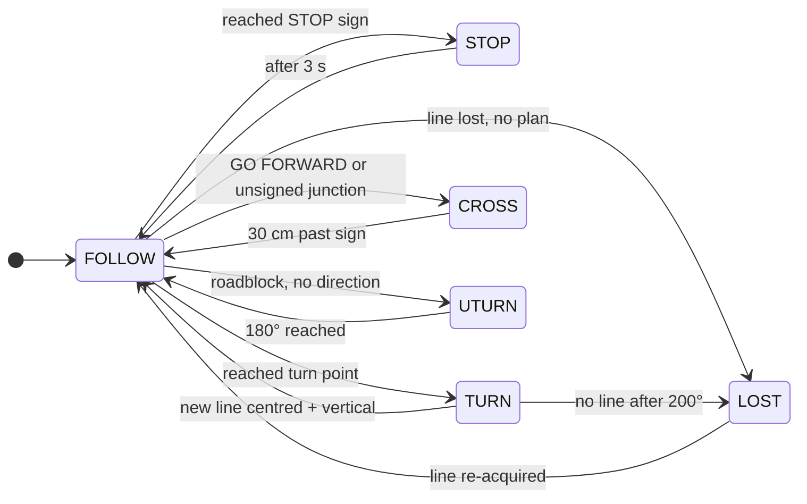

<div align="center">

# 🚗 ros2-vslam

### Lane-aware traffic-sign navigation for the AgileX LIMO

*Green-tape line following · YOLOv8 floor-sign detection · junction planning · odometry-based visual landmark mapping*

<br/>

[](https://docs.ros.org/)
[](https://www.python.org/)
[](https://opencv.org/)
[](https://docs.ultralytics.com/)

[](https://global.agilex.ai/products/limo)
[](#-hardware--assumptions)
[](https://numpy.org/)
[](https://universe.roboflow.com/syeds-workspace-csb5t/robotics-vision)
[](https://creativecommons.org/licenses/by/4.0/)
[](#-sign-classes)
[](#-architecture)
[](#-offline-simulation)
[](#-coursework-history)
[-critical?style=flat-square)](#-authorship)
[](#-authorship)

<br/>

[Overview](#-overview) •
[How it works](#-how-it-works) •
[Architecture](#-architecture) •
[Quick start](#-quick-start) •
[Tuning](#-tuning-guide) •
[Simulation](#-offline-simulation) •
[Repo layout](#-repository-layout) •
[Authorship](#-authorship)

</div>

---

## 📌 Overview

A single ROS 2 node (`COSC_4366EL_A3_G5.py`) that drives an **AgileX LIMO** around a road network made of **green tape**, reading **traffic signs lying flat on the floor** and obeying them like a car would:

| | Feature | Details |
|:-:|---|---|
| 🛣️ | **Line following** | Band-scan tracker with continuity, so it holds its strip through `+` crossings, T-junctions, Y-forks and dashed tape |
| 🪧 | **Sign detection** | YOLOv8n with 6 classes, per-label confidence gates and containment / oversize filtering |
| 📐 | **Floor projection** | Pinhole camera model turns every box into *(forward cm, lateral cm)* on the floor |
| 🚦 | **Lane gating** | Only signs in **your** lane count. Signs meant for cross traffic, oncoming traffic or the next junction are rejected |
| 🗳️ | **Junction planning** | Multi-frame voting absorbs model flicker; actions fire on odometry distance, even after the sign leaves view |
| 🗺️ | **VSLAM map** | Odometry trajectory + sign landmarks at their true bearing, rendered live and saved to JSON |
| 🐕 | **Motion watchdog** | Warns when commands are sent but odometry doesn't move |

> [!NOTE]
> 👤 **Solo project.** Group 5 had one member. Everything here was done by [**xuckless**](https://github.com/xuckless), from collecting and annotating the dataset and training the model to the navigation code and on-robot tuning. See [Authorship](#-authorship).

> [!IMPORTANT]
> **Why lane gating matters.** Signs lie flat on the floor, so a **GO FORWARD** arrow meant for traffic crossing from the left points *right* from this robot's view, and the model correctly reads it as **TURN RIGHT**. No confidence threshold can fix that. Deciding *which signs belong to us* by where they sit on the floor does.

---

## 🧠 How it works

### 1 · Which signs are ours?

Picture every junction as a `+` split into quadrants, with the robot driving **north** (up):

```
                     │ green │
         Q2          │ tape  │          Q1
   (southbound's     │       │    (westbound's
    sign: REJECT)    │       │     sign: REJECT, past junction)
  ───────────────────┼───────┼───────────────────
   crossing tape     │   ✚   │     crossing tape
  ───────────────────┼───────┼───────────────────
         Q3          │       │          Q4
   (eastbound's      │       │     ✅ OUR SIGN
    sign: REJECT,    │       │     right of strip,
    left side)       │   ▲   │     before the junction
                     │ robot │
```

Every YOLO box is projected onto the floor and checked against these rules:

| Check | Rule | Rejection shown on HUD |
|---|---|---|
| Range | Forward ≤ `DECISION_DISTANCE_CM` (45 cm; roadblocks 35 cm) | `too far` |
| Side | Lateral between `RIGHT_LANE_MIN_CM` and `RIGHT_LANE_MAX_CM` (right of strip) | `left side` / `far right` |
| Junction | Sign centre must not be past the crossing tape (detected per frame **and** remembered in odometry) | `past junction` |
| Roadblock exception | DEAD END / NO ENTRY may also sit **on the path** (top of a T) | — |
| Close-range misfire | NO ENTRY under 15 cm is ignored (model quirk) | `too close` |
| Handled zone | Signs around a junction already handled are ignored until the robot has left it | — |
| State | Signs are only read in `FOLLOW` / `STOP`, never while turning or crossing | — |

### 2 · What do we do there?

Accepted sightings build a **junction plan**. Each label must appear in `CONFIRM_HITS` frames, and **LEFT / RIGHT / FORWARD** compete by summed confidence, so a model that flickers between LEFT and RIGHT still gets outvoted. The nearest sign is the *anchor*; anything well past it belongs to the next junction.

| Signs in our lane | Behaviour |
|---|---|
| 🛑 **STOP** | Drive **to** the sign, wait 3 s, then carry out the rest of the plan |
| ↩️ **TURN LEFT** / ↪️ **TURN RIGHT** | Drive to sign + 8 cm, rotate until the new line is **centred and vertical** |
| ⬆️ **GO FORWARD** *or no sign* | Cross the junction, ignoring side branches and signs |
| ⛔ **NO ENTRY** / 🚧 **DEAD END** + a direction | Follow the direction |
| ⛔ / 🚧 alone | U-turn (180°) |
| ➖ Line lost | Coast 1.5 s (dashed tape) → look right → look left → wait |

### 3 · Steering

One line, two gains:

```math
\omega = -\left(K_{lat}\cdot e_{lat} + K_{head}\cdot e_{head}\right), \qquad v = v_{max}\left(1 - 0.5\,\tfrac{|\omega|}{\omega_{max}}\right)
```

The heading term is the physical derivative of the lateral error, so there's no separate I/D term, EMA filter or derivative kick to manage.

---

## 🏗️ Architecture



### State machine



---

## 🚀 Quick start

### Requirements

| Component | Version |
|---|---|
| ROS 2 | any distro with `rclpy`, `geometry_msgs`, `nav_msgs` |
| Python | 3.8+ |
| Packages | `ultralytics`, `opencv-python`, `numpy` |
| Robot | AgileX LIMO in **differential (4WD)** mode, base node publishing odometry |
| Weights | a trained YOLOv8 `best.pt` (not included in this repo) |

### Run

```bash
# 1. Start the LIMO base driver so /odom is published and /cmd_vel is consumed
#    (use the launch file that ships with your LIMO image)

# 2. Install Python dependencies on the robot
pip3 install ultralytics opencv-python numpy

# 3. Point YOLO_MODEL_PATH / MAP_SAVE_PATH at your files (top of the script), then:
source /opt/ros/$ROS_DISTRO/setup.bash
python3 COSC_4366EL_A3_G5.py
```

`Ctrl+C` stops the robot, then saves the map to `MAP_SAVE_PATH`.

### Windows

| Window | What you see |
|---|---|
| **LIMO Vision + YOLO** | Green overlay, line points + fit (red), **sign corridor** (yellow), junction line (magenta), boxes 🟩 accepted / 🟥 rejected with reason, FPS, state and plan |
| **Green Mask (ROI)** | Binary tape mask used by the tracker |
| **VSLAM Map** | Top-down trail, landmarks with hit counts, executed actions `L/R/F/S/U`, scale bar, legend |

---

## 🎛️ Tuning guide

All constants are at the top of `COSC_4366EL_A3_G5.py`. Tune in this order:

| # | Constant(s) | How |
|:-:|---|---|
| 1 | `CAMERA_HEIGHT_CM`, `CAMERA_TILT_DEG`, `DISTANCE_OFFSET_CM` | Put a sign at a known distance and compare with the `f…` value on its box |
| 2 | `TAPE_WIDTH_CM` | Measure the real strip. Used to recognise crossings and forks |
| 3 | `RIGHT_LANE_MIN_CM` / `RIGHT_LANE_MAX_CM` | Drive past each junction; only your own signs should turn green |
| 4 | `K_LATERAL`, `K_HEADING`, `MAX_ANGULAR` | Raise `K_LATERAL` until it oscillates, back off; add `K_HEADING` for curves |
| 5 | `TURN_OFFSET_CM`, `TURN_EXIT_HEADING_RAD` | Turning too early or late at junctions |
| 6 | `CONFIRM_HITS`, `SAME_JUNCTION_CM` | More flicker → raise `CONFIRM_HITS` |

> [!TIP]
> Every rejected box prints **why** it was rejected. If one of your own signs shows `left side` or `far right`, the corridor is too tight. If a cross-traffic sign turns green, it's too loose.

---

## 🧪 Offline simulation

`tests/sim_junctions.py` stubs out ROS 2 and YOLO, then exercises the real node code. It needs only `numpy` + `opencv-python`; no robot required.

```bash
python tests/sim_junctions.py
```

| Area | What's checked |
|---|---|
| Geometry | Floor projection ↔ pixel round-trip; matches the original tuned distance model |
| Line tracker | Straight, offset, leaning, `+` junction, Y-fork, dashed tape (synthetic masks) |
| Lane gating | Q1/Q2/Q3/Q4 signs, next-junction signs, top-of-T dead end |
| Scenarios | **A** `+` with GO FORWARD and cross traffic · **B** T with TURN RIGHT + DEAD END · **C** STOP + TURN LEFT · **D** lone DEAD END · **E** cross traffic only · **F** NO ENTRY pair + TURN LEFT |

The scenarios include 20% detection dropout, ±1 cm position noise and 30% LEFT↔RIGHT label flicker.

---

## 🪧 Sign classes

| ID | Label | Role |
|:-:|---|---|
| 0 | `DEAD END` | Roadblock (lower confidence gate: 0.35) |
| 1 | `GO FORWARD` | Direction |
| 2 | `NO ENTRY` | Roadblock |
| 3 | `STOP` | Stop at sign, 3 s |
| 4 | `TURN LEFT` | Direction |
| 5 | `TURN RIGHT` | Direction |

Dataset: [`robotics-vision`](https://universe.roboflow.com/syeds-workspace-csb5t/robotics-vision) on Roboflow Universe (CC BY 4.0), 272 images at 640×640, with exposure augmentation. **Collected, annotated, split and published by the author**, who also trained the model (YOLOv8n). See [Authorship](#-authorship).

> [!NOTE]
> When retraining, set `fliplr=0`. Ultralytics mirrors images by default, which turns TURN LEFT into TURN RIGHT while keeping the label. Also check that `train:` in `data.yaml` points at `train/images`.

---

## 📂 Repository layout

```
.
├── COSC_4366EL_A3_G5.py        # ⭐ main node: line following + signs + planning + VSLAM
├── tests/
│   └── sim_junctions.py        # offline simulator (ROS/YOLO stubbed)
├── COSC_4366EL_A2_G5.py        # A2: ROS 2 line-following node
├── COSC_4366EL_A1_G5_ML.py     # A1: YOLO sign detection + geometric distance
├── COSC_4366EL_A1_G5_CV.py     # A1: AprilTag (36h11) sign detection
├── robotics-vision-2/          # YOLOv8 dataset export (Roboflow)
├── roboflow-upload/            # script + bundle for deploying weights to Roboflow
└── model_artifacts.json        # YOLOv8n model metadata
```

### VSLAM output

`vslam_map.json`:

```jsonc
{
  "trajectory": [[x, y, yaw, t], ...],          // metres / rad / s, start pose = origin
  "landmarks":  {"STOP": [[x, y, hits], ...]},  // clustered within 20 cm
  "events":     [["LEFT", x, y, t], ...]        // executed manoeuvres
}
```

---

## 🔧 Hardware & assumptions

- 📷 Camera ≈ 20 cm above the floor, tilted 36° down, 48° vertical FOV, 640×480
- 🛞 LIMO in **differential** mode (turns rely on rotating in place)
- 🪧 Signs lie **flat on the floor**, right of the strip, before the junction they control (quadrant 4; paired signs may also appear in quadrant 3)
- 🟩 Track uses `+` crossings, T-junctions, curves / Y-forks, dead-end stubs and dashed segments

## ⚠️ Known limitations

- The map is odometry-based with no loop closure. Drift accumulates on long runs.
- Lateral gating is relative to the robot, not the tape, so it's less precise mid-curve.
- If the crossing tape is never detected, quadrant-1 signs are only rejected by the *nearest sign wins* rule.
- Gains and corridor bounds are first estimates and need tuning on the real track.

---

## 👤 Authorship

This was a **one-person group**. Every stage of the project was done by [**xuckless**](https://github.com/xuckless):

| Stage | Work done |
|---|---|
| 📸 **Data collection & curation** | Gathered and curated the sign images for all 6 classes |
| 🏷️ **Annotation** | Hand-labelled every bounding box (240 sign instances in the training set) in Roboflow |
| ✂️ **Train / valid / test splits** | Built and checked the splits (240 / 20 / 12 images) and the preprocessing + augmentation pipeline |
| 🧠 **Model training** | Fine-tuned **YOLOv8n** (Ultralytics, 640 px, batch 16) and deployed the weights to Roboflow |
| 🤖 **Robot software** | Designed the algorithms, state machines and process flow across A1–A3 |
| 🔧 **Testing & tuning** | All on-robot trial-and-error testing and constant tuning on the LIMO |

> [!NOTE]
> Claude Code was used as a development accelerator for the code. The ideas, core decisions and all of the data / model work are the author's own. See the disclaimer at the top of `COSC_4366EL_A3_G5.py`.

---

## 📜 Coursework history

| Assignment | File | Topic |
|:-:|---|---|
| A1 | `COSC_4366EL_A1_G5_CV.py` | AprilTag-based sign recognition |
| A1 | `COSC_4366EL_A1_G5_ML.py` | YOLOv8 sign detection + floor-distance estimation |
| A2 | `COSC_4366EL_A2_G5.py` | ROS 2 line-following node on the LIMO |
| A3 | `COSC_4366EL_A3_G5.py` | Full autonomous navigation + VSLAM |

<div align="center">

---

Built **solo** by [**xuckless**](https://github.com/xuckless) for **COSC 4366EL**: dataset, annotation, model training, robot software and tuning

</div>
